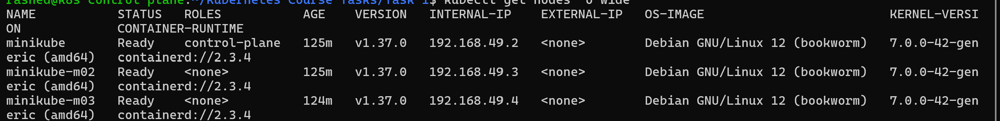
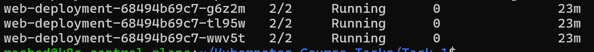
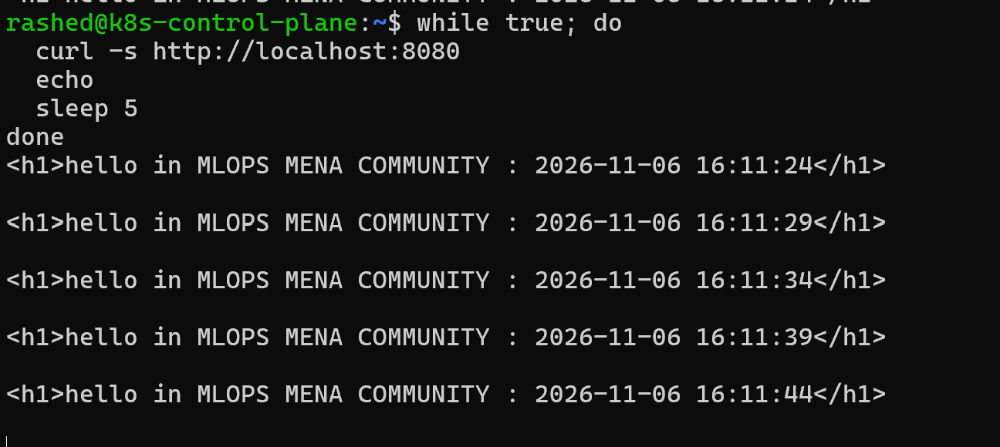
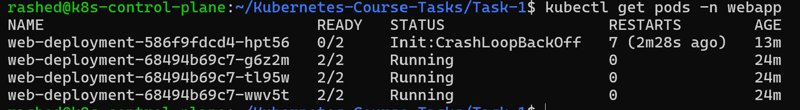
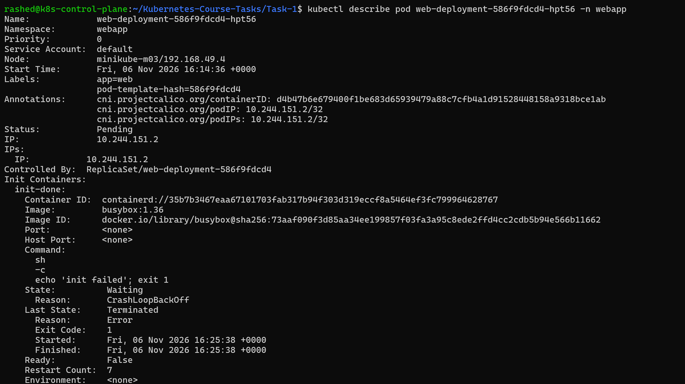
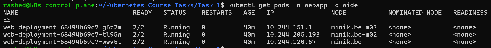

# Task 1: Multi-Container Pods (Init Container & Sidecar)

## Objective

Deploy an Nginx web application on a 3-node Kubernetes cluster using an Init Container and a Sidecar Container, without defining shared volumes.

## Environment

- VMware Workstation
- Ubuntu Linux
- Minikube (3 nodes)
- Docker Driver
- Calico CNI
- Kubernetes v1.37.0

## Architecture

The Deployment runs 3 replicas. Each Pod contains:

| Container | Image | Responsibility |
|---|---|---|
| init-done | busybox:1.36 | Prints `done` and exits successfully |
| nginx | nginx:1.27 | Serves an HTML page on port 80 |
| time-updater | busybox:1.36 | Updates the HTML page every 5 seconds |

The Pods use `shareProcessNamespace: true` so the Sidecar can access the Nginx process through `/proc/<PID>/root`.

## Implementation

### 1. Cluster Verification

`kubectl get nodes -o wide`

### 2. Deployment

`kubectl apply -f namespace.yaml`

`kubectl apply -f deployment.yaml`

`kubectl get pods -n webapp`

### 3. Application Verification

`kubectl port-forward -n webapp deploy/web-deployment 8080:80`

The application serves a hello page containing the current timestamp. The Sidecar updates the timestamp every 5 seconds.

### 4. Init Container Failure Test

Modified the Init Container command to:

`echo 'init failed'; exit 1`

Applied the failed Deployment manifest:

`kubectl apply -f deployment-failed.yaml`

The new Pod entered `Init:CrashLoopBackOff`, while the previous three Pods remained running.

### 5. Rolling Update Behavior

`kubectl rollout status deploy/web-deployment -n webapp --timeout=30s`

The rollout could not complete because the new Pod failed initialization.

The existing application remained available through the previous healthy Pods.

### 6. Recovery

Restored the successful Init Container command:

`echo done`

Reapplied the working manifest:

`kubectl apply -f deployment.yaml`

Verified the recovered Deployment:

`kubectl rollout status deploy/web-deployment -n webapp`

`kubectl get pods -n webapp`

## Key Learnings

- Init Containers must succeed before application containers start.
- Sidecar Containers can support the main application.
- Shared process namespaces allow containers in the same Pod to see each other's processes.
- Rolling Updates help preserve application availability during failed deployments.
- Kubernetes retries failed Init Containers with increasing delays.

## Cleanup (Optional)

`kubectl delete namespace webapp`

Keep the Minikube cluster running for Task 2.
